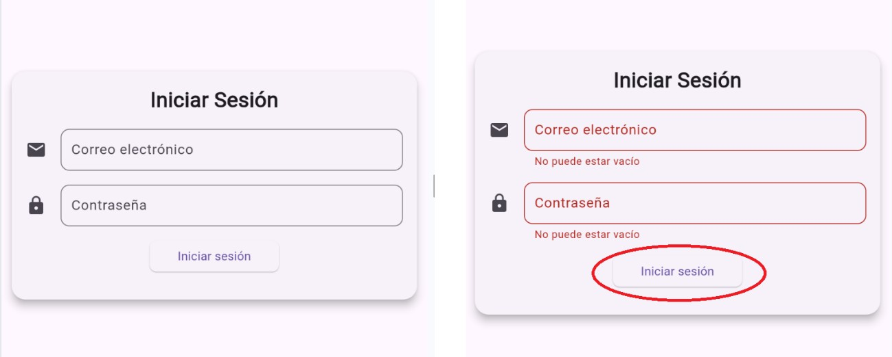
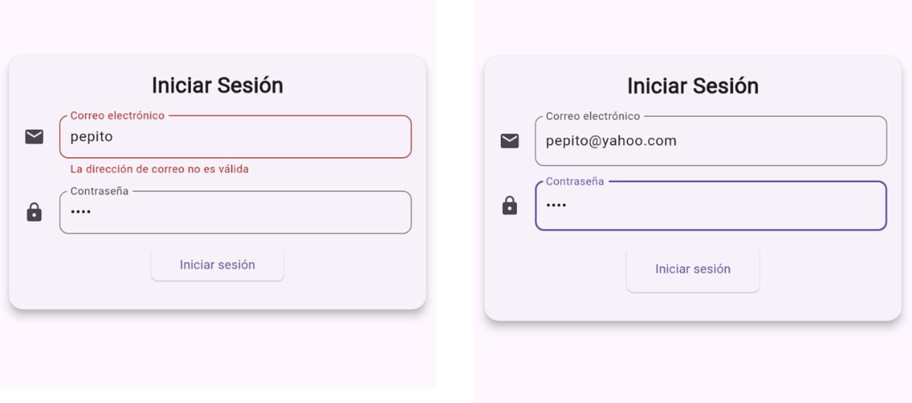
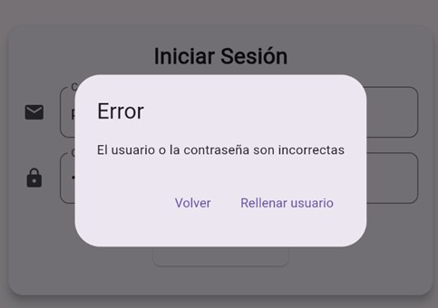
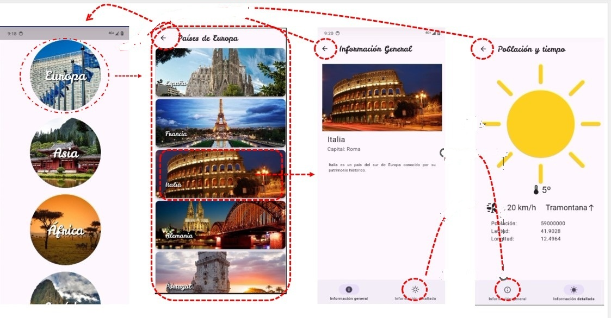
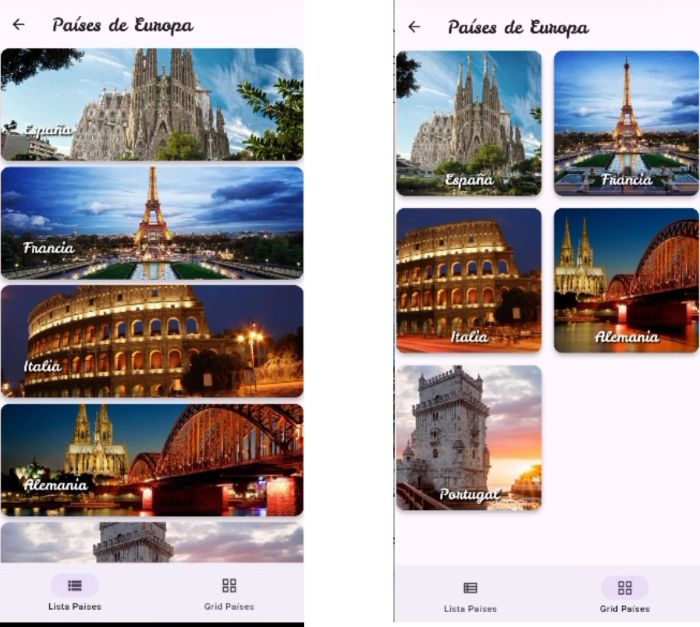
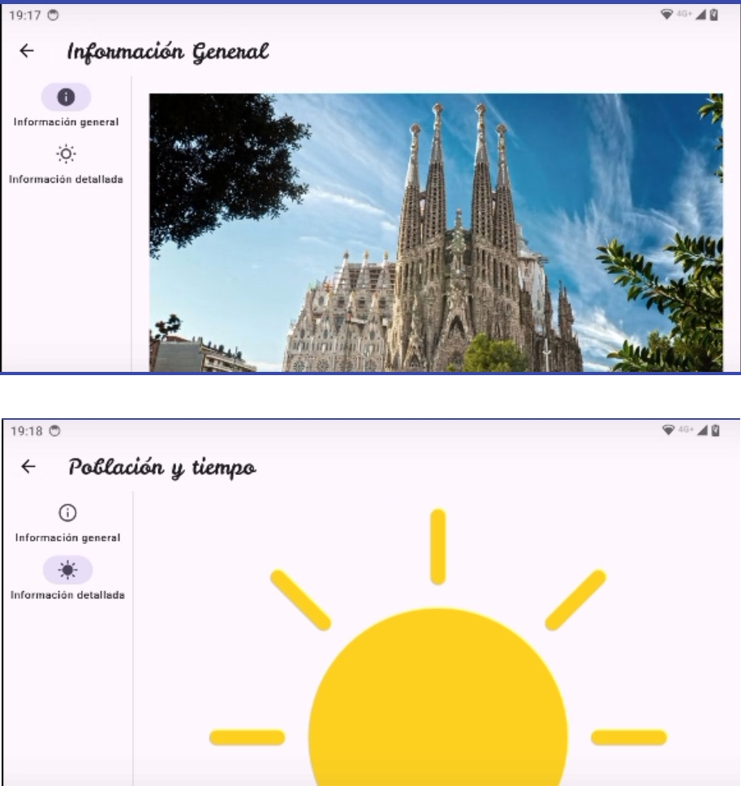
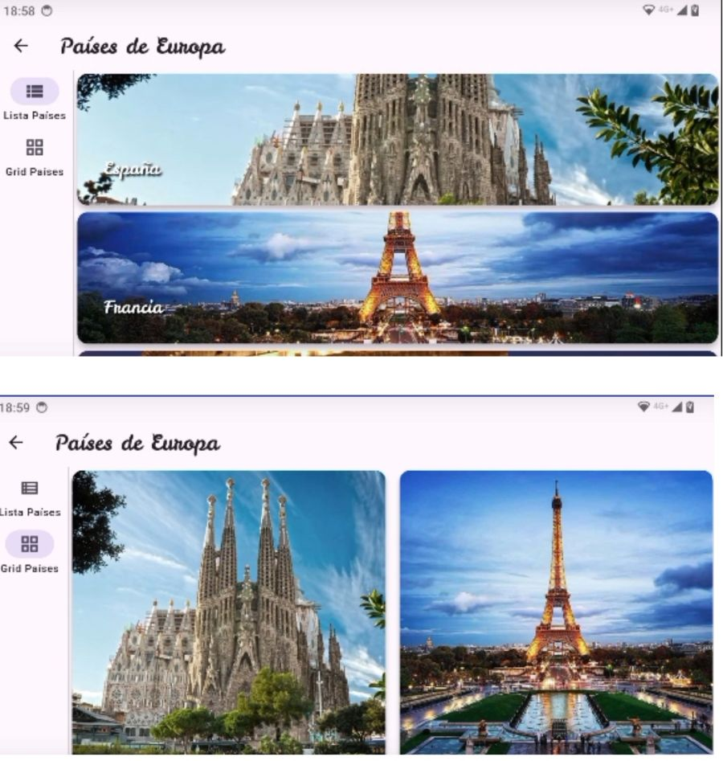

   

 
 

# Práctica 4. Formularios y Navegación 

Para esta tarea vamos a enlazar las distintas pantallas que generamos en la práctica 3, de manera que podamos navegar entre ellas.

En esta práctica utilizaremos una clase que nos proporcionará, a través del repositorio, la información sobre las diferentes provincias y comarcas. En prácticas posteriores enlazaremos este repositorio con la información que obtuvimos a través de la API en la práctica 1.

Os he dejado un fichero data.zip en el que tenemos la carpeta `data`, con un repositorio y un servicio de datos algo distinto al que teníamos en la práctica 3. El primer paso que podéis hacer es adaptar vuestra práctica 3 a este nuevo repositorio.

Una vez tengamos ese paso hecho, vamos a modificar nuestra práctica para que tenga la siguiente funcionalidad.

## Pantalla inicial. Formulario.

La pantalla inicial será un formulario con el siguiente funcionamiento:
 

 
Al pulsar **Iniciar sesión**, si el usuario y la contraseña son correctas (las elegís vosotros…) entraremos a la aplicación de comarcas (a la pantalla de Provincias).

En el caso que el usuario y/o la contraseña no sean correctas aparecerá un Diálogo con el siguiente aspecto:
 

Si el usuario pulsa **Volver** cerraremos el diálogo volviendo al formulario con los datos que hubiera.

En el caso que se pulse **Rellenar usuario** volveremos al formulario, pero habremos puesto en los TextField el usuario y la contraseña correctos para poder entrar en la aplicación.

 

## Aplicación. Navegación entre pantallas.

Una vez que, a través del formulario, hayamos entrado en la aplicación, el esquema de navegación que implementaremos será el siguiente:
 

- Desde la pantalla de **Continentes**, podremos hacer click en cada una de ellas para navegar con los países de ese continente. Os puede ayudar para este propósito el widget `InkWell`.

- La pantalla de **Países** (tendrá un texto en la AppBar), permitirá seleccionar un país y navegar a la pantalla con información sobre el mismo.

- La pantalla de información del país se creará nueva y tendrá un `Scaffold` con una barra de navegación que utilizará los widgets diseñados en la práctica anterior (habrá que quitarles el Scaffold). En la AppBar nos aparecerá información de lo que estamos mostrando. De momento la información del tiempo la dejamos como en la práctica anterior.

 

## Obtención de la Información

Como hemos dicho al principio de la práctica, se os ofrece un fichero **data.zip** en el que tenéis "completa" la capa data para utilizar en vuestro proyecto.

En el fichero `/lib/data/services/paises_ejemplo.dart` nos encontramos la clase `PaisesEjemplo` que nos ofrece una lista JSON con la información estructurada de los continentes y sus países.

En esta práctica vamos a trabajar ya con **todos los datos sobre los continentes y los países**. Esta información se encuentra en la clase `PaisesEjemplo` y se accede a ella a través de la clase `PaisesRepository`.

Nos encontramos en `PaisesRepository` los métodos que utilizábamos antes, pero con algunos cambios:

- El método `getContinentes()` obtendrá la lista de continentes de la clase `PaisesEjemplo`. Lo tenéis implementado, pero es interesante entender cómo funciona.

- El método `getPaises()` recibirá ahora un `String` con el nombre del continentes del que deseamos obtener los paises y devolverá una lista de países. Este método también está implementado.
  
- El método `infoPais()` recibirá un `String` con el nombre del país del que desesmoa obtener la información. Este método **lo debéis implementar vosotros**. Se recorrerá toda la información de continentes y países y devolverá un objeto de tipo `Pais` cuando encuentre el país con el nombre que se busca. Observad cómo trabajan los métodos anteriores y recordad el constructor `fromJSON` de la clase `Pais`.

 
Hasta aquí sería la práctica básica y obligatoria. 
 

## Ampliación de la práctica.

 

- Al elegir un continente mostrar un `NavigationBar` con los países correspondientes en formato List y en formato Grid:

 

 

- Investigar cómo detectar si nuestra app está en modo apaisado. En ese caso mostrar la pantalla de Información general e Información detallada de un país con un `NavigationRail` en vez del `NavigationBar` (si no estamos en modo apaisado la mostraremos tal y como se implementó en la parte básica, es decir con el `NavigationBar`):

 

 

- Si se ha implementado la pantalla Países de un Continente con el ListView y el GridView detectar el modo apaisado y también mostrar en ese caso con un `NavigationRail` en vez del `NavigationBar`:

 

 

Para la ENTREGA de la práctica recordad hacer `flutter clean` para que ésta llegue limpia y entregad también un **pequeño pdf** en el que expliquéis los pasos para la implementación de las distintas pantallas y las dificultades encontradas.

 

## Rúbrica

| Concepto | Valor         |
|----------|---------------------|
| Formulario Inicial: Interfaz    | 1.5 |
| Formulario Inicial: Funcionamiento    | 1.5           |
| Navegación correcta entre pantallas| 2  |
| Navigation **Bar**: Información General,  Información Detallada| 2   |
| **Ampliación** | |
| Navigation **Bar**: Lista Países, Grid Países| 1 |
| Navigation **Rail**: Info General, Grid Países  | 1  |
| Navigation **Rail**: Lista Países, Grid Países| 1 |

